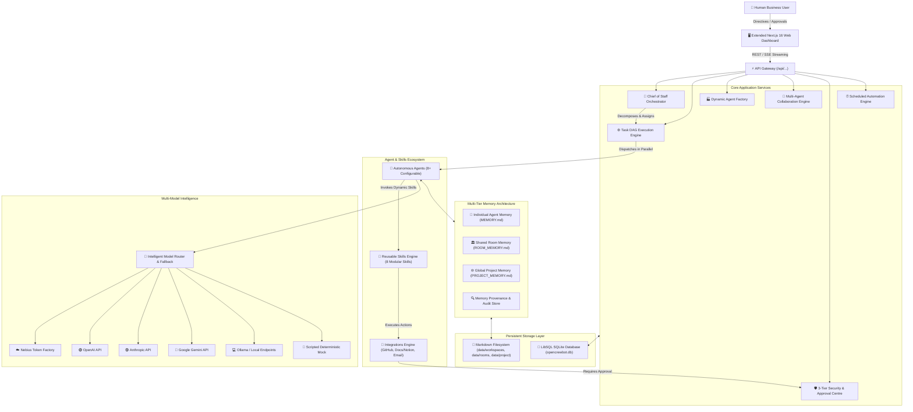

# OpenCrewBot 2.0 — Extended System Architecture

**OpenCrewBot 2.0** transforms the single-turn conversational interface of OpenCrewBot into a comprehensive, multi-agent autonomous enterprise AI workforce operating system.

---

## 1. High-Level System Architecture

---

## 2. Core Architectural Subsystems

### 2.1 Intelligent Chief of Staff & Orchestration (`src/lib/server/orchestration/`)
- **Intent Analysis:** Parses complex, unstructured user instructions to extract overarching business goals, constraints, and success criteria.
- **Task Decomposition:** Breaks down the objective into discrete subtasks structured as a Directed Acyclic Graph (DAG).
- **Capability Mapping:** Evaluates available agents against subtask requirements based on agent personas, skills, and tools.
- **Parallel & Sequential Dispatch:** Identifies independent subtasks to run concurrently across workers, while sequencing dependent subtasks with artifact passing.
- **Deliverable Synthesis:** Consolidates multi-agent research, analysis, and code outputs into a unified, executive-ready final report.

### 2.2 Task Execution Engine (`src/lib/server/tasks/`)
- **Task State Machine:** Tracks states: `PENDING` → `SCHEDULED` → `RUNNING` → `AWAITING_APPROVAL` → `COMPLETED` / `FAILED` / `CANCELLED`.
- **DAG Execution Coordinator:** Concurrently triggers runnable tasks whose dependencies are met.
- **Resilience & Recovery:** Configurable retry policies with exponential backoff, task timeouts, failure isolation, and fallback agents.
- **Execution History:** Comprehensive persistence of task runs, inputs, intermediate artifacts, timing metrics, and token consumption.

### 2.3 Dynamic Agent Factory (`src/lib/server/agent-factory/`)
- **Natural Language Agent Generation:** Takes a high-level prompt (e.g., *"Create a Senior Financial Analyst specialising in SaaS metrics"*) and automatically generates:
  - Agent Name, Title, and Emoji Avatar
  - System Instructions and Behavioral Persona
  - Recommended Model (Fast vs. Reasoning vs. Code)
  - Tool & Skill Permissions
  - Initial `MEMORY.md` file
  - Standard Output Format Specifications
- **Zero-Code Registration:** Directly writes new agent records to LibSQL and initializes their filesystem workspaces without requiring server restart or code compilation.

### 2.4 Multi-Agent Collaboration Engine (`src/lib/server/collaboration/`)
- **Collaboration Protocols:**
  - **Delegation:** Agents hand off specific sub-problems with structured input payloads.
  - **Peer Review & Verification:** Designated verifier agents challenge assumptions and audit outputs.
  - **Clarification:** Structured inter-agent Q&A with bounded resolution turns.
- **Loop Prevention:** Bounded delegation depth counters, conversation cycle detection, and token budgets prevent run-away interactions.

### 2.5 Multi-Tier Persistent Memory (`src/lib/server/memory/`)
1. **Tier 1 — Individual Agent Memory (`data/workspaces/<botId>/MEMORY.md`):** Private workspace containing agent preferences, personal heuristics, and working notes.
2. **Tier 2 — Shared Room Memory (`data/rooms/<roomId>/ROOM_MEMORY.md`):** Collective memory shared across all agents participating in a collaboration room.
3. **Tier 3 — Project Memory (`data/project/PROJECT_MEMORY.md`):** Global enterprise knowledge, business guidelines, company facts, and overarching rules.
4. **Memory Provenance:** Each memory item records:
   - *What* was learned (content)
   - *When* it was recorded (ISO timestamp)
   - *Why* it was recorded (decision, preference, finding)
   - *Where* it originated (user prompt, web research, tool output, agent name)

### 2.6 Reusable Skills Ecosystem (`src/lib/server/skills/`)
Implements 8 core modular skills:
1. **Market Research:** Industry sizing, macro trends, target customer segmentation.
2. **Competitor Analysis:** Feature matrix, pricing models, positioning analysis.
3. **Financial Modelling:** Unit economics, CAC/LTV, revenue projections, run-rate modeling.
4. **Presentation Creation:** Structured slide decks, narrative arcs, executive summaries.
5. **Email Drafting:** Cold outreach, partnership proposals, customer follow-ups.
6. **Code Review:** Static analysis, security auditing, maintainability recommendations.
7. **Data Analysis:** CSV/tabular calculations, conversion funnel analysis, KPI tracking.
8. **Lead Generation:** Ideal Customer Profile (ICP) scoring, prospect targeting, pipeline generation.

### 2.7 3-Tier Security & Approval Centre (`src/lib/server/security/`)
- **Tier 1: Ask First:** Every external write, email transmission, repository modification, or sensitive API call requires human approval with an explicit action preview.
- **Tier 2: Controlled Access:** Safe reads and pre-approved actions execute autonomously within strict rate, token, and domain boundaries.
- **Tier 3: Full Access:** Autonomous execution across permitted scopes, reserved for trusted background routines.
- **Approval Centre:** Centralized dashboard tab allowing administrators to inspect pending requests, review diffs, grant single-use or session approvals, or reject actions.
- **Audit Log:** Immutable audit log storing every decision, timestamp, actor, and payload.

### 2.8 Native Integrations Engine (`src/lib/server/integrations/`)
Provides three genuine, working native integrations:
1. **GitHub Integration:** Repository inspection, file reading, issue creation, and pull request drafting via GitHub REST API (with clear live/mock modes).
2. **Document & Notion Sync:** Markdown-based document synchronization for knowledge base management.
3. **Email & Communication Dispatcher:** Structured draft creation and dispatch for communications (with preview and approval gates).

### 2.9 Scheduled Automation Engine (`src/lib/server/scheduler/`)
- Background interval scheduler supporting recurring crons (daily competitor monitoring, weekly business reporting, repository monitoring).
- Pause, resume, trigger now, and full execution history with artifacts and status tracking.

### 2.10 Multi-Model Intelligence & Cost Tracking (`src/lib/server/llm/`)
- Provider abstraction layer supporting OpenAI, Anthropic, Google Gemini, Nebius, and local endpoints.
- Dynamic model routing: routes complex planning to reasoning models, and simple lookups to lightweight models.
- Real-time token consumption and USD cost analytics dashboard.
