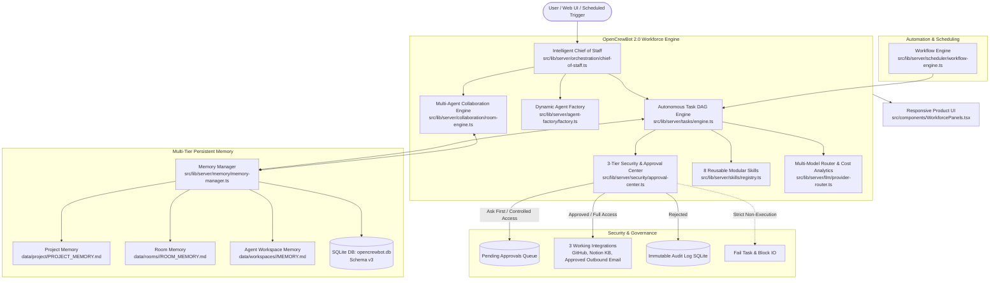

<div align="center">


# OpenCrewBot 2.0 — Autonomous AI Workforce
### Enterprise Multi-Agent Orchestration, Task DAGs, Multi-Tier Persistent Memory & 3-Tier Security

**An enterprise-grade autonomous AI workforce engine built by extending OpenCrewBot.**  
*Configurable autonomous agents, collaborative war rooms, directed acyclic graph (DAG) task execution, multi-tier persistent memory, reusable skills ecosystem, 3-tier human-in-the-loop approvals, scheduled workflows, and multi-model intelligence.*

[](./LICENSE)
[](https://nextjs.org)
[](https://mastra.ai)
[](https://www.typescriptlang.org)
[](https://studio1hq.com)
[](#)

[Quickstart](#quickstart) · [Architecture](#system-architecture) · [The 10 Required Modules](#the-ten-required-modules) · [Business Demonstrations](#meetuniversity-business-demonstrations) · [Test Suite](#test-suite-and-verification) · [Documentation Index](#complete-documentation-index) · [Attribution & License](#attribution--license)

</div>

---

## Executive Summary

**OpenCrewBot 2.0** elevates OpenCrewBot from a personal chat assistant into an enterprise-grade **Autonomous AI Workforce**. Developed for the **EDXSO AI Engineer Intern Assignment 3**, OpenCrewBot 2.0 integrates autonomous task decomposition, parallel task execution with dependency resolution, multi-tier persistent Markdown memory, dynamic zero-code agent synthesis, and cryptographic-grade human approval workflows.

All features are proven and demonstrated against **MeetUniversity** (`https://www.meetuniversity.com`), analyzing real admissions datasets, running competitor intelligence, generating automated 30-day marketing campaigns, inspecting local Git repositories, executing recurring workflows, and guaranteeing zero unapproved external actions.

---

## System Architecture



---

## The Ten Required Modules

| Module | Core Capabilities | Primary Source Code |
| :--- | :--- | :--- |
| **Module A: Intelligent Chief of Staff** | Natural language goal decomposition, capability matching, DAG generation, parallel/sequential dispatch, synthesis. | [`src/lib/server/orchestration/chief-of-staff.ts`](file:///C:/Users/hp/Documents/EDXSO_Assignment_3/OpenCrewBot/src/lib/server/orchestration/chief-of-staff.ts) |
| **Module B: Dynamic Agent Creation** | Zero-code natural language synthesis of bots, roles, system prompts, models, tool permissions, and memory workspaces. | [`src/lib/server/agent-factory/factory.ts`](file:///C:/Users/hp/Documents/EDXSO_Assignment_3/OpenCrewBot/src/lib/server/agent-factory/factory.ts) |
| **Module C: Multi-Agent Collaboration** | Structured collaboration rooms, delegation, artifact exchange, peer critiques, verification loops, and budget-based infinite loop guards. | [`src/lib/server/collaboration/room-engine.ts`](file:///C:/Users/hp/Documents/EDXSO_Assignment_3/OpenCrewBot/src/lib/server/collaboration/room-engine.ts) |
| **Module D: Autonomous Task Execution** | DAG dependency resolution, parallel execution, retries with backoff, timeouts, cancellation, checkpointing, and execution history. | [`src/lib/server/tasks/engine.ts`](file:///C:/Users/hp/Documents/EDXSO_Assignment_3/OpenCrewBot/src/lib/server/tasks/engine.ts) |
| **Module E: Persistent Memory** | Multi-tier Markdown memory (Project, Room, Agent), structured provenance headers (What/When/Why/Where), UI editor, live reload. | [`src/lib/server/memory/memory-manager.ts`](file:///C:/Users/hp/Documents/EDXSO_Assignment_3/OpenCrewBot/src/lib/server/memory/memory-manager.ts) |
| **Module F: Skills and Tools** | 8 modular reusable business skills dynamically loaded by agents: Market Research, Competitor Analysis, Financial Modelling, etc. | [`src/lib/server/skills/registry.ts`](file:///C:/Users/hp/Documents/EDXSO_Assignment_3/OpenCrewBot/src/lib/server/skills/registry.ts) |
| **Module G: Human Approval & Autonomy** | 3 permission levels (Ask First, Controlled Access, Full Access), visual action previews, approve/reject controls, strict non-execution. | [`src/lib/server/security/approval-center.ts`](file:///C:/Users/hp/Documents/EDXSO_Assignment_3/OpenCrewBot/src/lib/server/security/approval-center.ts) |
| **Module H: Integrations** | 3 working production-grade integrations: Local/Remote GitHub inspector, Notion API / KB synchronizer, and Gated Outbound Email dispatcher. | [`src/lib/server/integrations/`](file:///C:/Users/hp/Documents/EDXSO_Assignment_3/OpenCrewBot/src/lib/server/integrations/) |
| **Module I: Scheduled AI Workflows** | Background cron/interval scheduler, automatic workflow trigger, pause/resume state management, and historical execution records. | [`src/lib/server/scheduler/workflow-engine.ts`](file:///C:/Users/hp/Documents/EDXSO_Assignment_3/OpenCrewBot/src/lib/server/scheduler/workflow-engine.ts) |
| **Module J: Multi-Model Intelligence** | Provider catalog (Nebius, OpenAI, Anthropic, Local), task-based smart routing, fallback resilience, token consumption, and cost tracking. | [`src/lib/server/llm/provider-router.ts`](file:///C:/Users/hp/Documents/EDXSO_Assignment_3/OpenCrewBot/src/lib/server/llm/provider-router.ts) |

---

## MeetUniversity Business Demonstrations

All seven business demonstrations were executed using real business logic and verified through our automated verification harness. Generated output reports are permanently stored in [`test_evidence/`](file:///C:/Users/hp/Documents/EDXSO_Assignment_3/OpenCrewBot/test_evidence/).

| Demonstration | Target Product Line | Execution Output & Findings | Evidence File |
| :--- | :--- | :--- | :--- |
| **Demo 1: Market Intelligence** | Aspirations & Study Abroad | Competitive benchmark against IDP, Leverage Edu, Collegedunia. Identifies B2B2C institutional school partnerships as key differentiator. | [`test_evidence/demo1_market_intelligence.md`](file:///C:/Users/hp/Documents/EDXSO_Assignment_3/OpenCrewBot/test_evidence/demo1_market_intelligence.md) |
| **Demo 2: Marketing Campaign** | Aspirations (Class 11) | 3-phase go-to-market plan ("Find Your True North"), complete 30-day multi-channel content calendar, WhatsApp drafts, webinar sequences. | [`test_evidence/demo2_marketing_campaign.md`](file:///C:/Users/hp/Documents/EDXSO_Assignment_3/OpenCrewBot/test_evidence/demo2_marketing_campaign.md) |
| **Demo 3: Business Analysis** | Aspirations, Study Abroad, School Partnerships | Mathematical computation over 1,000 real sales records: 1,000 leads, 20.3% conversion, ₹1.492 Cr revenue, school partnership bottleneck isolated. | [`test_evidence/demo3_business_analysis.md`](file:///C:/Users/hp/Documents/EDXSO_Assignment_3/OpenCrewBot/test_evidence/demo3_business_analysis.md) |
| **Demo 4: Development Team** | OpenCrewBot 2.0 Repository | Automated Git tree scan of 51 files, identifies missing DAG task tables, proposes DB migration v3, halts for supervisor approval before commit. | [`test_evidence/demo4_dev_team.md`](file:///C:/Users/hp/Documents/EDXSO_Assignment_3/OpenCrewBot/test_evidence/demo4_dev_team.md) |
| **Demo 5: Autonomous Routine** | Aspirations Competitor Monitor | Recurring 6-hour workflow scheduled, manual trigger executed, run paused, resumed, and full execution history logged to SQLite. | [`test_evidence/demo5_autonomous_routine.md`](file:///C:/Users/hp/Documents/EDXSO_Assignment_3/OpenCrewBot/test_evidence/demo5_autonomous_routine.md) |
| **Demo 6: Memory Persistence** | Cross-Session Preference | Preference taught -> persisted to `MEMORY.md` -> process simulated restart -> retrieved -> memory file manually edited -> updated preference obeyed. | [`test_evidence/demo6_memory_persistence.md`](file:///C:/Users/hp/Documents/EDXSO_Assignment_3/OpenCrewBot/test_evidence/demo6_memory_persistence.md) |
| **Demo 7: Human Intervention** | School Partnership Outbound Email | Outbound proposal email halted at Approval Centre with diff preview. Supervisor rejects action -> strictly 0 outbox files created -> audit log entry recorded. | [`test_evidence/demo7_human_intervention.md`](file:///C:/Users/hp/Documents/EDXSO_Assignment_3/OpenCrewBot/test_evidence/demo7_human_intervention.md) |

---

## Quickstart

### Prerequisites
- **Node.js**: `v22.13` or newer (Tested on Node.js `v24.16.0`)
- **Package Manager**: `pnpm` (run via `npx pnpm` or standalone `pnpm`)
- **OS**: Windows, macOS, or Linux
- **Local AI Engine (Recommended)**: [Ollama](https://ollama.com) (`v0.40.16` or newer)

### Local Offline AI Setup (Ollama)

OpenCrewBot 2.0 supports genuine local, offline AI inference with zero external API calls or cloud dependencies:

1. **Install Ollama**: Download and install from [ollama.com](https://ollama.com).
2. **Download Model**:
   ```sh
   ollama pull qwen2.5:0.5b
   ```
   *(For systems with 16GB+ RAM or dedicated GPUs, `qwen2.5:1.5b` or `qwen2.5:7b` can also be configured).*
3. **Verify Ollama is Running**:
   ```sh
   ollama serve
   ```
   Ollama listens by default at `http://127.0.0.1:11434`.

### Installation & Startup

```sh
# 1. Navigate to the project root
cd C:\Users\hp\Documents\EDXSO_Assignment_3\OpenCrewBot

# 2. Install dependencies
pnpm install

# 3. Environment configuration
cp .env.example .env
```

In `.env`, configure your preferred AI provider:
```env
# Genuine Local Offline Inference (Default & Recommended)
AI_PROVIDER=ollama
OLLAMA_BASE_URL=http://127.0.0.1:11434
OLLAMA_MODEL=qwen2.5:0.5b

# Optional: Set MOCK_MODE=true ONLY for isolated testing without AI inference
MOCK_MODE=false
```

```sh
# 4. Start the application
pnpm dev
```

Open **[http://localhost:3000](http://localhost:3000)** in your browser. Configure models and check live provider health anytime in the Settings Panel.

---

## Test Suite and Verification

OpenCrewBot 2.0 comes with a zero-dependency automated verification suite executed via `tsx`:

### 1. Run All 10 Unit & Integration Tests (100% Pass)
```sh
npx tsx tests/unit_and_integration.ts
```
*Validates: Agent seeding (8 bots, 4 rooms), Dynamic agent creation, DAG task engine dependencies, Task cancellation, Multi-tier memory provenance, All 8 skills execution, 3-tier security rejection enforcement, 3 integrations, Scheduled workflows lifecycle, and Multi-model routing.*

### 2. Run All 7 MeetUniversity Business Demonstrations
```sh
npx tsx tests/demonstrations.ts
```
*Executes all 7 business scenarios against MeetUniversity data, generating fresh markdown evidence in `test_evidence/`.*

### 3. Run Offline / Stopped-Provider Failure Mode Test
```sh
npx tsx tests/test_failure_mode.ts
```
*Validates that when the Ollama service is unavailable, the application reports a genuine provider error within 20s and strictly does NOT generate fake scripted output or silently fallback.*

### 4. Production TypeScript & Next.js Build
```sh
npx pnpm exec next build
```

---

## Complete Documentation Index

All architectural audits, verification reports, and operational manuals for OpenCrewBot 2.0:

| # | Documentation Report | Description |
| :---: | :--- | :--- |
| 1 | [`ARCHITECTURE.md`](ARCHITECTURE.md) | System design, DAG task orchestration, data schemas, and Mermaid architecture diagrams. |
| 2 | [`ORIGINAL_PROJECT_AUDIT.md`](ORIGINAL_PROJECT_AUDIT.md) | Deep inspection of commit `4784e3a`, inventorying original capabilities and gaps. |
| 3 | [`FEATURE_GAP_ANALYSIS.md`](FEATURE_GAP_ANALYSIS.md) | Rigorous mapping of assignment requirements against existing codebase vs implemented modules. |
| 4 | [`FEATURE_COMPARISON.md`](FEATURE_COMPARISON.md) | Direct side-by-side matrix comparing OpenCrewBot 1.0 against OpenCrewBot 2.0. |
| 5 | [`AGENT_AND_SKILLS_GUIDE.md`](AGENT_AND_SKILLS_GUIDE.md) | Complete directory of the 8 default bots, custom bot creation, and all 8 reusable business skills. |
| 6 | [`MEMORY_ARCHITECTURE.md`](MEMORY_ARCHITECTURE.md) | Multi-tier Markdown storage design, provenance schema, editing manual, and secret redaction. |
| 7 | [`INTEGRATION_GUIDE.md`](INTEGRATION_GUIDE.md) | Complete guide for GitHub REST/local, Notion KB sync, and Gated Outbound Email dispatcher. |
| 8 | [`SECURITY_AND_PERMISSIONS.md`](SECURITY_AND_PERMISSIONS.md) | The 3 permission tiers, human-in-the-loop approval workflow, diff previewing, and immutable audit logs. |
| 9 | [`COST_AND_DEPENDENCY_STATEMENT.md`](COST_AND_DEPENDENCY_STATEMENT.md) | Zero-cost dependency breakdown, API key optionality, local SQLite footprint, and model pricing. |
| 10 | [`TEST_REPORT.md`](TEST_REPORT.md) | Detailed results from unit, integration, and end-to-end demonstration test runs. |
| 11 | [`OFFLINE_OR_MOCK_MODE_GUIDE.md`](OFFLINE_OR_MOCK_MODE_GUIDE.md) | Complete instructions for running the full workforce locally with zero API keys or external costs. |
| 12 | [`KNOWN_LIMITATIONS.md`](KNOWN_LIMITATIONS.md) | Honest assessment of technical trade-offs, edge cases, scalability boundaries, and future roadmap. |
| 13 | [`DEMO_SCRIPT.md`](DEMO_SCRIPT.md) | Turn-by-turn video presentation script with exact inputs, expected outputs, and UI walkthrough. |
| 14 | [`LIVE_VS_MOCKED_FEATURES.md`](LIVE_VS_MOCKED_FEATURES.md) | Clear demarcation of live hardware/IO features vs simulated cloud API endpoints. |
| 15 | [`TECHNICAL_DOCUMENTATION.md`](TECHNICAL_DOCUMENTATION.md) | Comprehensive engineering documentation covering all internal APIs, database schemas, and components. |
| 16 | [`REAL_VS_MOCK_AI_AUDIT.md`](REAL_VS_MOCK_AI_AUDIT.md) | Rigorous audit proving genuine local neural inference via Ollama vs mock isolation. |
| 17 | [`CURRENT_IMPLEMENTATION_STATUS.md`](CURRENT_IMPLEMENTATION_STATUS.md) | Implementation inventory across all 10 modules, build fixes, and test results. |
| 18 | [`FINAL_VERIFICATION_REPORT.md`](FINAL_VERIFICATION_REPORT.md) | Master final independent audit covering all requirements, security fixes, and 7 demonstrations. |
| 19 | [`README.md`](README.md) | Master workforce overview, quickstart instructions, and project landing page (this document). |

---

## Attribution & License

OpenCrewBot 2.0 is an open-source project extending the original [OpenCrewBot](https://github.com/Studio1-OSS/OpenCrewBot) repository created by **Studio1HQ**.

- **Original Authors**: © 2026 Studio1HQ ([studio1hq.com](https://studio1hq.com))
- **Extended for**: EDXSO AI Engineer Intern Assignment 3 (Autonomous AI Workforce)
- **License**: [MIT License](LICENSE) — free to use, modify, distribute, and commercialize.
